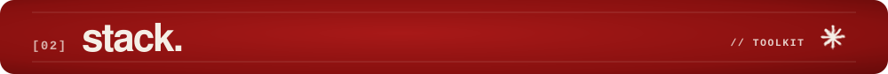

<div align="center">


</div>

<br/>


<div align="center">

</div>

```text
+--------------------------------------------------------------+
|  HANDLE      @hellyeahk                                      |
|  DISCIPLINE  creative media & front-end                      |
|  OBSESSION   interactive canvas, visual web experiments      |
|  MEDIUM      HTML5 / JS / 60FPS, generative art, UI          |
|  ARCHIVE     curated github pages, procedural flora          |
|  CONTACT     telegram @YUFANZUAO                             |
+--------------------------------------------------------------+
```

<br/>



<div align="center">

</div>

<br/>


<!-- ============ EXP.001 — FEATURED ============ -->
<table width="100%">
<tr>
<td width="60%" valign="top">
  
  <a href="https://hellyeahk.github.io/red-roses/">
    
  </a>
</td>
<td width="40%" valign="top">
  <br/>
  <h2>red roses.</h2>
  <p>
    Real-time procedural bloom simulation exploring organic layering,
    custom easing transitions, and dynamic light gradients on HTML5 Canvas.
  </p>
  <p>
    
    
    
  </p>
  <p>
    <a href="https://hellyeahk.github.io/red-roses/"><strong>↗&nbsp;LAUNCH EXPERIMENT</strong></a><br/>
    <sub><a href="https://github.com/hellyeahk/red-roses">inspect source →</a></sub>
  </p>
</td>
</tr>
</table>

<!-- ============ EXP.002 + EXP.003 ============ -->
<table width="100%">
<tr>
<td width="50%" valign="top">
  
  <h3>stylized terrarium &amp; virtual companion.</h3>
  <p>2D canvas state machine and tactile micro-interactions.</p>
  <p>
    
    
    
  </p>
</td>
<td width="50%" valign="top">
  
  <h3>motion &amp; spatial web prototypes.</h3>
  <p>Custom easing curves, shaders and interactive layouts.</p>
  <p>
    
    
    
  </p>
  <p><a href="https://github.com/hellyeahk?tab=repositories"><strong>↗&nbsp;BROWSE INDEX</strong></a></p>
</td>
</tr>
</table>

<br/>


<div align="center">


<br/><br/>

<picture>
  <source media="(prefers-color-scheme: dark)" srcset="https://raw.githubusercontent.com/hellyeahk/hellyeahk/output/snake-dark.svg"/>
  <source media="(prefers-color-scheme: light)" srcset="https://raw.githubusercontent.com/hellyeahk/hellyeahk/output/snake-light.svg"/>
  
</picture>

</div>

<br/>


<div align="center">

[](https://t.me/YUFANZUAO)
[](https://hellyeahk.github.io/)

<br/>


</div>
