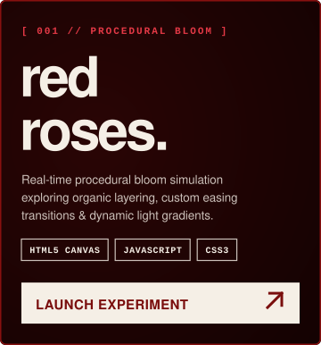
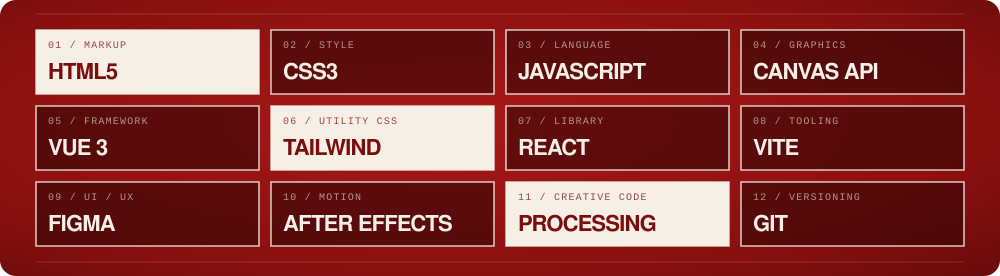

  
   
  

 

 

<!-- ROW 1: EXP.001 + GIF (Kiri) & LAB-URL + LAB-DESC (Kanan) -->
<table width="100%">
  <tr>
    <td width="62%" valign="top">
      
      
    </td>
    <td width="38%" valign="top">
      
      
    </td>
  </tr>
</table>

<!-- ROW 2: LAB-002, LAB-003, LAB-004 (3 Kolom) -->
<table width="100%">
  <tr>
    <td width="33.3%" valign="top">
      
    </td>
    <td width="33.3%" valign="top">
      
    </td>
    <td width="33.3%" valign="top">
      
    </td>
  </tr>
</table>

<!-- ROW 3: INSPECT SOURCE & ALL EXPERIMENTS (2 Kolom) -->
<table width="100%">
  <tr>
    <td width="50%" valign="top">
      
    </td>
    <td width="50%" valign="top">
      
    </td>
  </tr>
</table>

 

 

  
  <picture>
    <source media="(prefers-color-scheme: dark)" srcset="https://raw.githubusercontent.com/hellyeahk/hellyeahk/output/github-snake-dark.svg" />
    <source media="(prefers-color-scheme: light)" srcset="https://raw.githubusercontent.com/hellyeahk/hellyeahk/output/github-snake.svg" />
    
  </picture>
  
  

 

  

 

  
   
  

