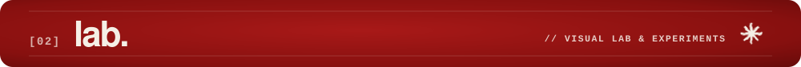
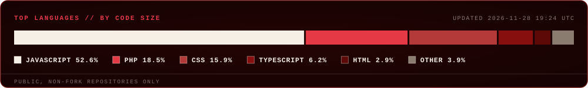

 

 

 

<!-- row 0 -->

 
<!-- row 1: hero -->

 
<!-- row 2 -->

 
<!-- row 3 -->

 

<!-- stats are generated by .github/workflows/snake.yml into the output branch -->

 

 

 

 
<picture>
  <source media="(prefers-color-scheme: dark)" srcset="https://raw.githubusercontent.com/hellyeahk/hellyeahk/output/snake-dark.svg"/>
  <source media="(prefers-color-scheme: light)" srcset="https://raw.githubusercontent.com/hellyeahk/hellyeahk/output/snake-light.svg"/>
  
</picture>

 

 

