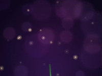

<div align="center">
  
  <a href="https://github.com/hellyeahk">
    
  </a>
  <br/>
  
  
  
</div>

<br/>

### `01` — featured exhibition

<table width="100%">
  <tr>
    <td width="56%" align="center">
      <a href="https://hellyeahk.github.io/red-roses/">
        
      </a>
    </td>
    <td width="44%" valign="middle">
      <h3>red roses.</h3>
      <p>
        Interactive procedural rose bloom simulation rendered in real time. Built with layered petal gradients, organic cluster formations, and smooth easing curves.
      </p>
      <p>
        <code>HTML5 Canvas</code> <code>CSS3</code> <code>JavaScript</code>
      </p>
      <p>
        <a href="https://hellyeahk.github.io/red-roses/"><strong>↗ launch live page</strong></a> &nbsp;·&nbsp;
        <a href="https://github.com/hellyeahk/red-roses">source code</a>
      </p>
    </td>
  </tr>
</table>

<table width="100%">
  <tr>
    <td width="50%" align="center" valign="top">
      <a href="https://hellyeahk.github.io/lily_stargazer/">
        
      </a>
      <br/>
      <strong>stargazer lily.</strong><br/>
      <sub>procedural canvas bloom · <a href="https://hellyeahk.github.io/lily_stargazer/"><strong>live demo ↗</strong></a></sub>
    </td>
    <td width="50%" align="center" valign="top">
      <a href="https://hellyeahk.github.io/higanbana/">
        
      </a>
      <br/>
      <strong>higanbana (spider lily).</strong><br/>
      <sub>curved filament study · <a href="https://hellyeahk.github.io/higanbana/"><strong>live demo ↗</strong></a></sub>
    </td>
  </tr>
</table>

<br/>

### `02` — system spec & focus

```javascript
const jeremiah = {
  name:     "Jeremiah Hawthorne",
  handle:   "@hellyeahk",
  telegram: "@yufanzuao",
  focus:    "Interactive Canvas & Visual Web Experiments",
  role:     "Creative media & front-end engineering",
  loves:    ["UI/UX", "motion graphics", "generative canvas", "CSS animations"],
  building: ["Vue 3", "React", "full-stack web", "procedural flora"],
  funFact:  "I'd rather spend an hour on an easing curve than skip it."
};
