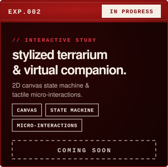
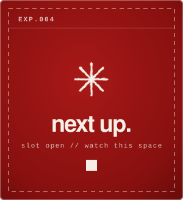

  
   
  

 

 

<table width="100%">
  <tr>
    <td width="58%" align="center">
      
    </td>
    <td width="42%" valign="middle">
      
      
      
      
    </td>
  </tr>
</table>

<table width="100%">
  <tr>
    <td width="33.3%" align="center">
      
    </td>
    <td width="33.3%" align="center">
      
    </td>
    <td width="33.3%" align="center">
      
    </td>
  </tr>
</table>

  

 

 

  
  <picture>
    <source media="(prefers-color-scheme: dark)" srcset="https://raw.githubusercontent.com/hellyeahk/hellyeahk/output/github-snake-dark.svg" />
    <source media="(prefers-color-scheme: light)" srcset="https://raw.githubusercontent.com/hellyeahk/hellyeahk/output/github-snake.svg" />
    
  </picture>

 

  

