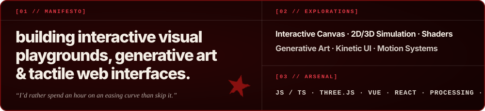

  

 

  

 

### `[04]` — visual lab & experiments

<table width="100%">
  <tr>
    <td width="60%" align="center">
      
    </td>
    <td width="40%" valign="middle">
      <code>EXP. 001 // PROCEDURAL CANVAS</code>
      <h2>red roses.</h2>
      

        Real-time procedural bloom simulation exploring organic layering, custom easing transitions, and dynamic light gradients on HTML5 Canvas.
      

      

        <code>HTML5 CANVAS</code> &nbsp; <code>JAVASCRIPT</code> &nbsp; <code>CSS3</code>
      

       
      

        <a href="https://hellyeahk.github.io/red-roses/"><strong>↗ LAUNCH EXPERIMENT</strong></a> 
        <a href="https://github.com/hellyeahk/red-roses">inspect source →</a>
      

    </td>
  </tr>
</table>

<table width="100%">
  <tr>
    <td width="33.3%" align="left" valign="top">
      
       
      <code>EXP. 002 // INTERACTIVE TOY</code> 
      <strong>experiment 02.</strong> 
      canvas physics &amp; state · <a href="https://hellyeahk.github.io/nama-proyek-2/"><strong>open ↗</strong></a>
    </td>
    <td width="33.3%" align="left" valign="top">
      
       
      <code>EXP. 003 // GENERATIVE STUDY</code> 
      <strong>experiment 03.</strong> 
      procedural geometry · <a href="https://hellyeahk.github.io/nama-proyek-3/"><strong>open ↗</strong></a>
    </td>
    <td width="33.3%" align="left" valign="top">
      
       
      <code>EXP. 004 // MOTION / UI</code> 
      <strong>experiment 04.</strong> 
      kinetic web interface · <a href="https://hellyeahk.github.io/nama-proyek-4/"><strong>open ↗</strong></a>
    </td>
  </tr>
</table>

 

  
    <strong>DIRECT CHANNEL:</strong> <a href="https://t.me/yufanzuao">TELEGRAM (@YUFANZUAO)</a>
    &nbsp;&nbsp;//&nbsp;&nbsp;
    <strong>FULL INDEX:</strong> <a href="https://github.com/hellyeahk?tab=repositories">ALL REPOSITORIES ↗</a>
  
    
  

