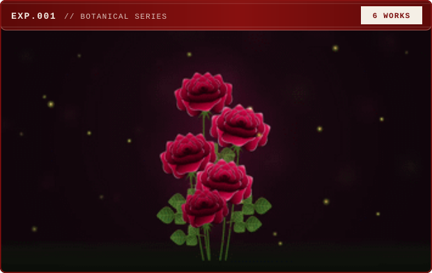
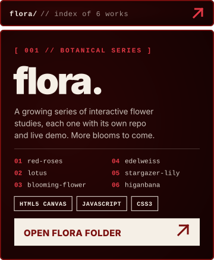
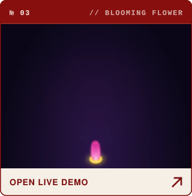
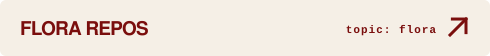
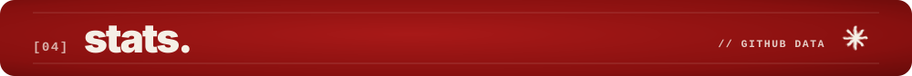
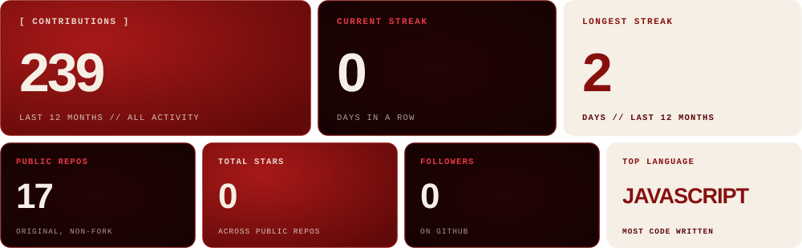

  
   
  

 

<picture>
  <source media="(max-width: 600px)" srcset="assets/manifesto-m.svg" />
  
</picture>

  <b>Jeremiah Hawthorne</b> · interactive canvas &amp; visual web experiments. 
  Currently: <a href="https://github.com/hellyeahk?tab=repositories&q=topic%3Aflora"><b>flora</b></a>, a series of botanical studies · 6 works live.

 

<!--
  Responsive layout without CSS: every tile is ONE image with a fixed pixel width.
  On a laptop they sit side by side; on a phone they wrap to one per row.
  Keep the sum of widths on a row under ~800.
-->

<b>SOURCE →</b> <a href="https://github.com/hellyeahk/red-roses">red-roses</a> · <a href="https://github.com/hellyeahk/lotus">lotus</a> · <a href="https://github.com/hellyeahk/blooming-flower">blooming-flower</a> · <a href="https://github.com/hellyeahk/edelweiss">edelweiss</a> · <a href="https://github.com/hellyeahk/stargazer-lily">stargazer-lily</a> · <a href="https://github.com/hellyeahk/higanbana">higanbana</a>

  

 

<picture>
  <source media="(max-width: 600px)" srcset="assets/stack-m.svg" />
  
</picture>

 

  
  <picture>
    <source media="(prefers-color-scheme: dark)" srcset="https://raw.githubusercontent.com/hellyeahk/hellyeahk/output/snake-framed-dark.svg" />
    <source media="(prefers-color-scheme: light)" srcset="https://raw.githubusercontent.com/hellyeahk/hellyeahk/output/snake-framed-light.svg" />
    
  </picture>
  <picture>
  <source media="(max-width: 600px)" srcset="https://raw.githubusercontent.com/hellyeahk/hellyeahk/output/stats-metrics-m.svg" />
  
</picture>
  <picture>
  <source media="(max-width: 600px)" srcset="https://raw.githubusercontent.com/hellyeahk/hellyeahk/output/stats-langs-m.svg" />
  
</picture>

 

 

  
   
  

