<div align="center">




</div>

<br/>


<div align="center">

</div>

```text
+--------------------------------------------------------------+
|  HANDLE      @hellyeahk                                      |
|  DISCIPLINE  creative media & front-end                      |
|  OBSESSION   interactive canvas, visual web experiments      |
|  MEDIUM      HTML5 / JS / 60FPS, generative art, UI          |
|  ARCHIVE     curated github pages, procedural flora          |
|  CONTACT     telegram @YUFANZUAO                             |
+--------------------------------------------------------------+
```

<br/>


<div align="center">

</div>

<br/>


<!--
  GANTI baris di bawah dengan proyekmu sendiri.
  Salin satu baris tabel untuk menambah entri baru.
-->

| NO. | PAGE | MEDIUM | LINK |
|:---:|:-----|:-------|:----:|
| **001** | **PROCEDURAL FLORA** — plants that grow themselves, drawn on canvas | HTML5 canvas · JS | [**OPEN ↗**](https://hellyeahk.github.io/) |
| **002** | **NAMA_PROYEK** — satu kalimat tegas tentang apa ini | TECH · TECH | [**OPEN ↗**](https://hellyeahk.github.io/) |
| **003** | **NAMA_PROYEK** — satu kalimat tegas tentang apa ini | TECH · TECH | [**OPEN ↗**](https://hellyeahk.github.io/) |
| **004** | **NAMA_PROYEK** — satu kalimat tegas tentang apa ini | TECH · TECH | [**OPEN ↗**](https://hellyeahk.github.io/) |

<div align="right">

**[ ALL REPOSITORIES → ](https://github.com/hellyeahk?tab=repositories)**

</div>

<br/>


<div align="center">


<br/><br/>

<picture>
  <source media="(prefers-color-scheme: dark)" srcset="https://raw.githubusercontent.com/hellyeahk/hellyeahk/output/snake-dark.svg"/>
  <source media="(prefers-color-scheme: light)" srcset="https://raw.githubusercontent.com/hellyeahk/hellyeahk/output/snake-light.svg"/>
  
</picture>

</div>

<br/>


<div align="center">

[](https://t.me/YUFANZUAO)
[](https://hellyeahk.github.io/)

<br/>


</div>
