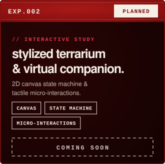
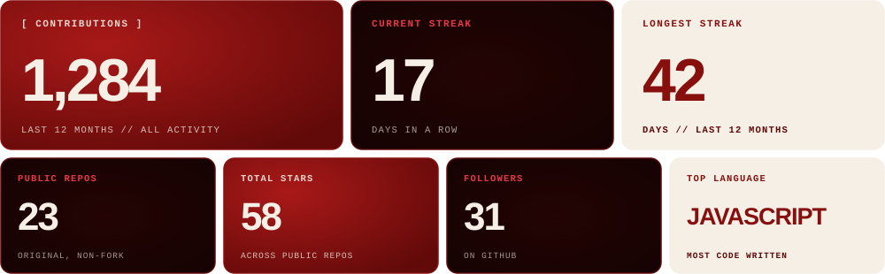
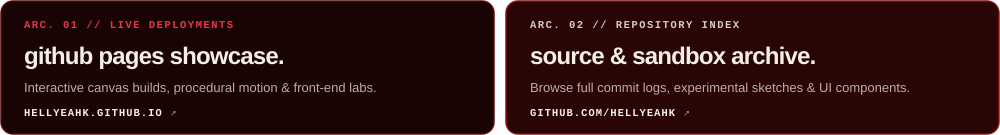

<!-- ROW 1: EXP.001 + GIF (Kiri) & LAB-URL + LAB-DESC (Kanan) -->
<table width="100%">
<tr>
    <td width="58%" align="center">
    <td width="62%" valign="top">
      
 
</td>
    <td width="42%" valign="middle">
      
      
    <td width="38%" valign="top">
 
      <a href="https://github.com/hellyeahk/red-roses">
        
      
</td>
</tr>
</table>

<!-- ROW 2: LAB-002, LAB-003, LAB-004 (3 Kolom) -->
<table width="100%">
<tr>
    <td width="33%" align="center" valign="top">
    <td width="33.3%" valign="top">
 
</td>
    <td width="33%" align="center" valign="top">
    <td width="33.3%" valign="top">
 
</td>
    <td width="34%" align="center" valign="top">
    <td width="33.3%" valign="top">
 
</td>
</tr>
</table>

  

<!-- ROW 3: INSPECT SOURCE & ALL EXPERIMENTS (2 Kolom) -->
<table width="100%">
  <tr>
    <td width="50%" valign="top">
      
    </td>
    <td width="50%" valign="top">
      
    </td>
  </tr>
</table>

 

@@ -74,47 +85,27 @@
<source media="(prefers-color-scheme: light)" srcset="https://raw.githubusercontent.com/hellyeahk/hellyeahk/output/github-snake.svg" />

</picture>
  
  

 

<table width="100%">
  <tr>
    <td width="50%" valign="top">
      <code>ARC. 01 // GENERATIVE WEB</code> 
      <strong><a href="https://hellyeahk.github.io/red-roses/">red-roses ↗</a></strong> 
      Real-time HTML5 Canvas procedural bloom &amp; lighting study.
    </td>
    <td width="50%" valign="top">
      <code>ARC. 02 // FULL REPOSITORY INDEX</code> 
      <strong><a href="https://github.com/hellyeahk?tab=repositories">github.com/hellyeahk ↗</a></strong> 
      Complete directory of interactive web demos, canvas sketches &amp; UI builds.
    </td>
  </tr>
</table>

  

 

<table width="100%">
  <tr>
    <td width="50%" align="center" valign="middle">
      <code>DIRECT MESSAGE</code> 
      <strong><a href="https://t.me/yufanzuao">↗ TELEGRAM — @YUFANZUAO</a></strong>
    </td>
    <td width="50%" align="center" valign="middle">
      <code>GITHUB PROFILE</code> 
      <strong><a href="https://github.com/hellyeahk">↗ GITHUB — @HELLYEAHK</a></strong>
    </td>
  </tr>
</table>

 

  
   

