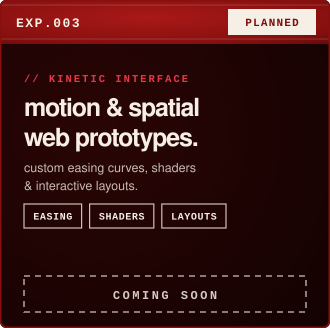

<!-- ROW 1: EXP.001 Hero Compilation -->
<table width="100%">
  <tr>
    <td width="62%" valign="top">
      
      
    </td>
    <td width="38%" valign="top">
      
      
    </td>
  </tr>
</table>

<!-- ROW 2: Direct Live Demo Gallery (3x2 Grid) -->
<table width="100%">
  <tr>
    <td width="33.3%" valign="top">
      
      
    </td>
    <td width="33.3%" valign="top">
      
      
    </td>
    <td width="33.3%" valign="top">
      
      
    </td>
  </tr>
  <tr>
    <td width="33.3%" valign="top">
      
      
    </td>
    <td width="33.3%" valign="top">
      
      
    </td>
    <td width="33.3%" valign="top">
      
      
    </td>
  </tr>
</table>

<!-- ROW 3: Planned / Next Slots -->
<table width="100%">
  <tr>
    <td width="33.3%" valign="top">
      
    </td>
    <td width="33.3%" valign="top">
      
    </td>
    <td width="33.3%" valign="top">
      
    </td>
  </tr>
</table>

<!-- ROW 4: Browse Links -->
<table width="100%">
  <tr>
    <td width="50%" valign="top">
      
    </td>
    <td width="50%" valign="top">
      
    </td>
  </tr>
</table>
