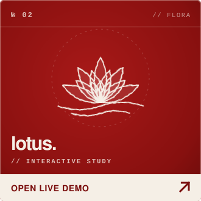
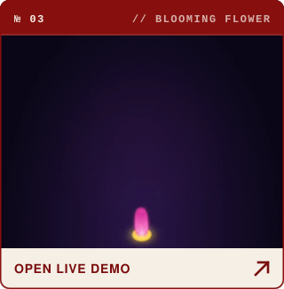
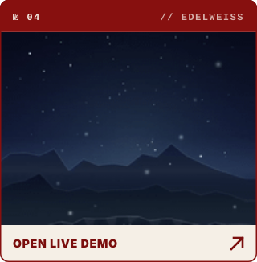

  

  A series of interactive botanical studies. 
  Each work lives in its own repository with its own live demo, and this page is the index.

<table width="100%">
  <tr>
    <td width="33.3%" valign="top">
      
      
    </td>
    <td width="33.3%" valign="top">
      
      
    </td>
    <td width="33.3%" valign="top">
      
      
    </td>
  </tr>
  <tr>
    <td width="33.3%" valign="top">
      
      
    </td>
    <td width="33.3%" valign="top">
      
      
    </td>
    <td width="33.3%" valign="top">
      
      
    </td>
  </tr>
</table>

 

plain-text index

 

| № | Work | Live | Source |
|---|------|------|--------|
| 01 | red roses | [demo](https://hellyeahk.github.io/red-roses/) | [red-roses](https://github.com/hellyeahk/red-roses) |
| 02 | lotus | [demo](https://hellyeahk.github.io/lotus/) | [lotus](https://github.com/hellyeahk/lotus) |
| 03 | blooming flower | [demo](https://hellyeahk.github.io/blooming-flower/) | [blooming-flower](https://github.com/hellyeahk/blooming-flower) |
| 04 | edelweiss | [demo](https://hellyeahk.github.io/edelweiss/) | [edelweiss](https://github.com/hellyeahk/edelweiss) |
| 05 | stargazer lily | [demo](https://hellyeahk.github.io/stargazer-lily/) | [stargazer-lily](https://github.com/hellyeahk/stargazer-lily) |
| 06 | higanbana | [demo](https://hellyeahk.github.io/higanbana/) | [higanbana](https://github.com/hellyeahk/higanbana) |

  <a href="https://github.com/hellyeahk?tab=repositories&q=topic%3Aflora">all repositories tagged <code>flora</code></a>
  ·
  <a href="../README.md">← back to profile</a>

