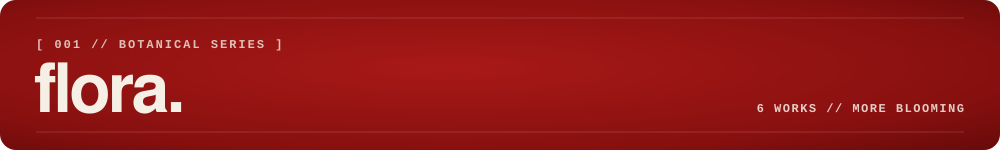
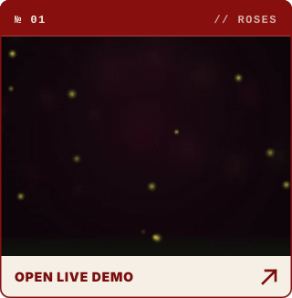
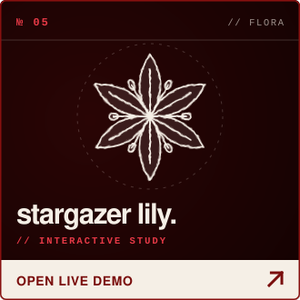
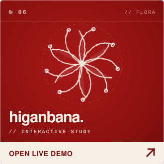
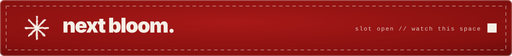

  

 

  A series of interactive botanical studies. 
  Each work lives in its own repository with its own live demo, and this page is the index.

 

<b>SOURCE →</b> <a href="https://github.com/hellyeahk/red-roses">red-roses</a> · <a href="https://github.com/hellyeahk/lotus">lotus</a> · <a href="https://github.com/hellyeahk/blooming-flower">blooming-flower</a> · <a href="https://github.com/hellyeahk/edelweiss">edelweiss</a> · <a href="https://github.com/hellyeahk/stargazer-lily">stargazer-lily</a> · <a href="https://github.com/hellyeahk/higanbana">higanbana</a>

 

  <a href="https://github.com/hellyeahk">← back to profile</a>

